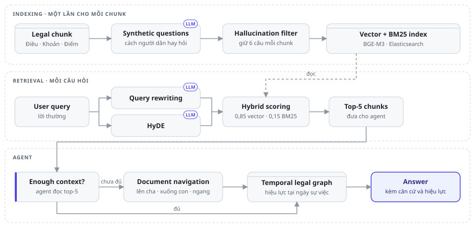
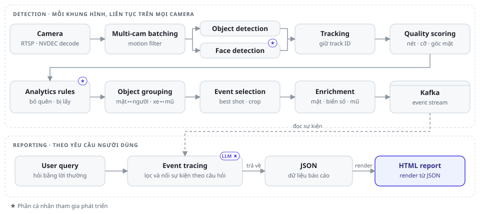
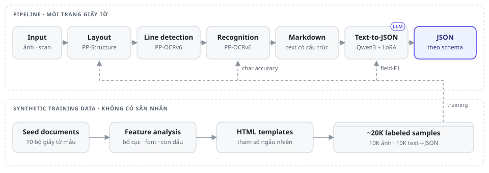
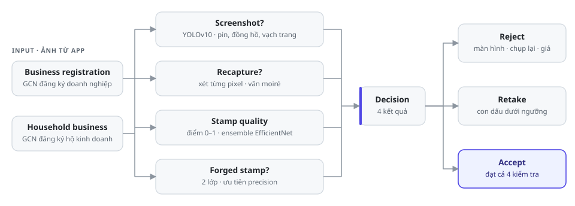

  

  

  Kỹ sư AI với chuyên môn xây dựng hệ thống từ dữ liệu, huấn luyện model đến triển khai production, 
  trong các lĩnh vực <b>ngân hàng</b>, <b>pháp luật</b>, <b>an ninh</b> và <b>giáo dục trực tuyến</b>.

  <b>@PhucCodeAI</b>
  &nbsp;&nbsp;·&nbsp;&nbsp;
  <a href="https://www.linkedin.com/in/phuccodeai"><b>LinkedIn</b></a>
  &nbsp;&nbsp;·&nbsp;&nbsp;
  Hà Nội, Việt Nam

 

## Dự án tiêu biểu

<table>
  <tr>
    <td width="50%" valign="top">
      <h3>Legal Agent</h3>
      
<i>Trả lời câu hỏi pháp luật trên kho hơn 500.000 văn bản (hơn 10 triệu chunk theo Điều, Khoản, Điểm), kèm kiểm tra hiệu lực và tác động.</i>

      <ul>
        <li>Kết hợp <b>synthetic question</b> cho từng chunk, <b>query rewriting</b> và <b>HyDE</b> trên nền <b>BGE-M3 + BM25</b>: Hit@5 tăng từ <b>78,5% lên 90,5%</b>, context gửi LLM giảm <b>59%</b></li>
        <li><b>Temporal legal graph</b> trên <b>NebulaGraph</b> cho biết điều khoản nào còn hiệu lực vào đúng ngày xảy ra sự việc</li>
        <li>Benchmark <b>18 embedding model</b> và <b>379 cấu hình chunking</b> trên bộ 400 câu hỏi tự xây</li>
      </ul>
      
     

    </td>
    <td width="50%" valign="top">
      <h3>Realtime Video Analytics</h3>
      
<i>Phát hiện sự kiện trên camera an ninh, mỗi cụm GPU chạy tối đa 20 camera ở 15 fps, và tổng hợp thành báo cáo khi người dùng cần.</i>

      <ul>
        <li>Luật <b>vật bỏ quên</b> và <b>vật bị lấy</b> bằng computer vision. Người vận hành chỉ cần chọn một mức độ nhạy, hệ thống tự suy ra toàn bộ ngưỡng kỹ thuật bên dưới</li>
        <li><b>Face detection</b> và <b>face recognition</b>, tìm embedding trên Milvus</li>
        <li><b>LLM</b> đọc lại sự kiện trong Kafka theo câu hỏi của người dùng, trả về <b>JSON</b> để giao diện render thành báo cáo HTML</li>
      </ul>
      
     

    </td>
  </tr>
  <tr>
    <td width="50%" valign="top">
      <h3>Image-to-JSON Pipeline</h3>
      
<i>Service dùng chung, biến ảnh chụp và bản scan giấy tờ thành dữ liệu có cấu trúc. Trước đây mỗi trang phải nhập tay mất 3–10 phút.</i>

      <ul>
        <li>Chọn pipeline <b>layout → dòng → OCR → Markdown → LLM</b>, vì VLM nhỏ dù đã fine-tune vẫn bịa nội dung và lặp chữ</li>
        <li>Chỉ có <b>10 bộ giấy tờ mẫu</b>, nên tự sinh <b>20.000 mẫu có nhãn</b> từ template HTML với tham số ngẫu nhiên</li>
        <li>Fine-tune <b>Qwen3 0,6B → 4B + LoRA</b> cho từng nhóm giấy tờ, đạt <b>trên 95%</b> character accuracy và field-F1; serve trên <b>Triton A100</b></li>
      </ul>
      
    

    </td>
    <td width="50%" valign="top">
      <h3>Business Registration Verification</h3>
      
<i>Kiểm tra ảnh Giấy chứng nhận đăng ký doanh nghiệp và đăng ký hộ kinh doanh mà khách tải lên khi mở tài khoản trên mobile banking app.</i>

      <ul>
        <li><b>Chấm chất lượng con dấu</b> thành điểm liên tục 0–1 bằng ensemble 3 model EfficientNet</li>
        <li><b>Phát hiện con dấu giả</b> trên dữ liệu lệch 99/1, ưu tiên precision để không chặn nhầm khách thật</li>
        <li>Phát hiện <b>screenshot</b> (YOLOv10) và <b>ảnh chụp lại màn hình</b> ở mức pixel; class bị hỏng được cứu bằng cách gán nhãn lại và tắt mosaic augmentation</li>
      </ul>
      
   

    </td>
  </tr>
  <tr>
    <td width="50%" valign="top">
      <h3>LLM Learning Chatbot</h3>
      
<i>Chatbot dùng GPT cho một nền tảng học tiếng Anh trực tuyến, hỗ trợ cả việc dạy lẫn việc học.</i>

      <ul>
        <li><b>Tool calling</b> và <b>structured output</b> để tra khóa học, luyện tập, ra đề, chấm bài và giải thích đáp án</li>
        <li><b>RAG</b> với <b>hybrid search</b> và re-ranking</li>
        <li>Bộ evaluation nội bộ theo dõi chất lượng câu trả lời qua từng phiên bản</li>
      </ul>
      
    

    </td>
    <td width="50%" valign="top">
      <h3><a href="https://github.com/PhucCodeAI/arxiv-research-agent">arXiv Research Agent</a></h3>
      
<i>Trợ lý nghiên cứu: thu thập bài báo arXiv theo chủ đề, từ khóa và mốc thời gian, hỏi đáp sâu về từng bài.</i>

      <ul>
        <li>ReAct agent (LangGraph, Gemini) tự chọn giữa web search và đọc full-text PDF</li>
        <li>Mỗi PDF chỉ phân tích một lần thành bản tóm tắt có cấu trúc (contributions, method, experiments, limitations), cache trong MongoDB cho các câu hỏi sau</li>
        <li>Crawler có deduplication, embedding được upsert vào Qdrant; FastAPI stream câu trả lời, giao diện Streamlit, chạy bằng Docker Compose</li>
      </ul>
      
      

    </td>
  </tr>
</table>

## Kiến trúc hệ thống

### Legal Agent: tìm đúng điều khoản rồi kiểm tra hiệu lực

<picture>
  <source media="(prefers-color-scheme: dark)" srcset="assets/legal-dark.svg">
  
</picture>

Người dân hỏi bằng lời thường, còn luật viết bằng thuật ngữ pháp lý. Vì vậy mỗi chunk được index kèm vài câu hỏi giả định theo cách người dân hay hỏi, và câu hỏi của người dùng được viết lại sang ngôn ngữ luật trước khi tìm. Nếu top-5 chưa đủ, agent tự đi lên điều cha, xuống khoản con hoặc sang điều liên quan, rồi tra graph để biết điều khoản đó còn hiệu lực vào ngày xảy ra sự việc hay không.

| Retrieval (400 câu hỏi) | Hit@5 | Acc@1 | Token gửi LLM |
|---|---:|---:|---:|
| BGE-M3 + BM25 (baseline) | 78,5% | 54,0% | 8.666 |
| **Pipeline cuối** | **90,5%** | **68,2%** | **3.560** |

Cải thiện rõ nhất ở nhóm câu hỏi ngắn, diễn đạt khác hẳn văn bản luật: Hit@5 từ **47% lên 82%**. Reranker và metadata filter do LLM chọn cũng đã thử, nhưng không vượt được pipeline này nên bị loại.

### Realtime Video Analytics: phát hiện liên tục, báo cáo khi cần

<picture>
  <source media="(prefers-color-scheme: dark)" srcset="assets/video-dark.svg">
  
</picture>

Khung hình được decode ngay trên GPU, đi qua motion filter, detection, tracking và chấm chất lượng rồi mới tới các luật phân tích. Mỗi sự kiện chỉ giữ lại khung hình đẹp nhất trước khi đẩy vào Kafka. Khi cần báo cáo, người dùng hỏi bằng lời thường; LLM đọc lại sự kiện trong Kafka, trả về JSON và giao diện render thành báo cáo.

### Image-to-JSON Pipeline: năm bước, bước nào cũng kiểm tra được

<picture>
  <source media="(prefers-color-scheme: dark)" srcset="assets/ocr-dark.svg">
  
</picture>

Pipeline được tách thành từng bước để khi một trường JSON sai, nhìn output của từng bước là biết lỗi ở layout, OCR, bước ghép Markdown hay LLM. Dữ liệu render từ template HTML nên có sẵn nhãn cho cả ba bước.

### Business Registration Verification: bốn bước kiểm tra, ba loại kết quả

<picture>
  <source media="(prefers-color-scheme: dark)" srcset="assets/verify-dark.svg">
  
</picture>

Áp dụng cho cả Giấy chứng nhận đăng ký doanh nghiệp lẫn đăng ký hộ kinh doanh. Ảnh là screenshot, ảnh chụp lại màn hình hoặc có con dấu giả thì bị từ chối ngay. Nếu chỉ là con dấu mờ, thiếu nét, app yêu cầu khách chụp lại thay vì từ chối, để không loại oan hồ sơ thật.

## Công nghệ

<table>
  <tr>
    <td width="22%"><b>LLM & Agent</b></td>
    <td>LangGraph · Function Calling · GraphRAG · Hybrid Search · Advanced RAG · LoRA / QLoRA · DPO</td>
  </tr>
  <tr>
    <td><b>Computer Vision</b></td>
    <td>OCR · VLM · YOLO · Face Recognition · Object Tracking · OpenCV</td>
  </tr>
  <tr>
    <td><b>Dữ liệu</b></td>
    <td>Elasticsearch · NebulaGraph · Neo4j · Qdrant · Milvus · MongoDB · Kafka · MinIO</td>
  </tr>
  <tr>
    <td><b>Triển khai</b></td>
    <td>PyTorch · Triton · FastAPI · Docker · Kubernetes · Jenkins · AWS · vLLM</td>
  </tr>
</table>

## Học vấn

- **Thạc sĩ Khoa học Máy tính**, Học viện Công nghệ Bưu chính Viễn thông · 2026 – 2028 (dự kiến)
- **Kỹ sư Công nghệ Thông tin**, Trường Đại học Mỏ - Địa chất · 2021 – 2026

